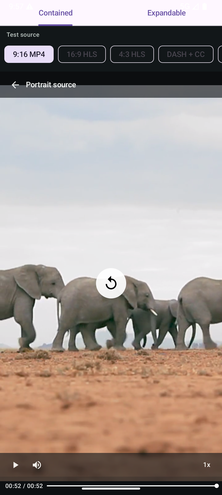
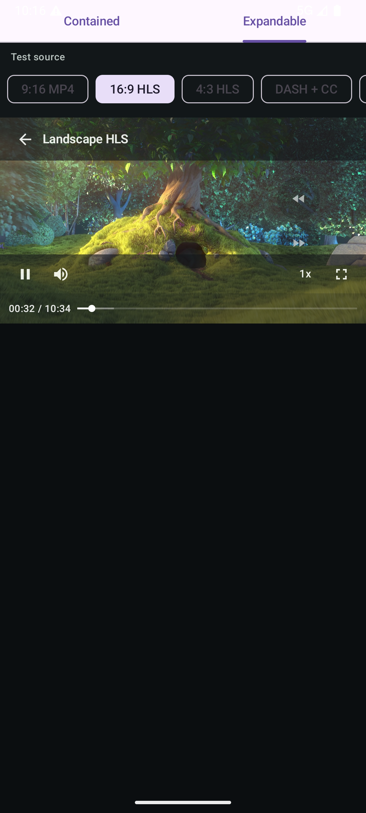
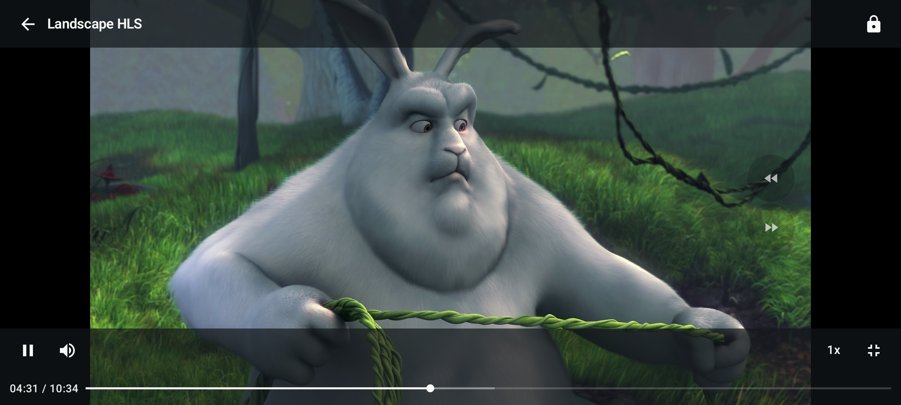

# MobilePlayer 1.0.0

Android 原生视频播放器库。 `player-core` 提供与播放器 SDK 无关的状态与控制能力，`player-compose` 只读取 `PlayerState` 并调用 `PlayerController`。Media3、IjkPlayer 和第三方自定义内核都通过同一套引擎接口接入。

当前版本实现普通视频、HLS/DASH、换核、首帧、进度、缓冲、轨道和错误状态，以及可配置的 Compose 播放器 UI。统一状态已为直播、DVR 时间线和直播边缘预留模型；后续版本可在不改变 UI 接口的前提下扩展直播策略。

## 模块

| 模块 | 职责 |
| --- | --- |
| `player-core` | `PlayerController` 接口、统一只读状态、引擎注册、缓存与环境控制 |
| `player-engine-media3` | Media3 Adapter，支持渐进式、HLS 和 DASH |
| `player-engine-ijk` | IjkPlayer Adapter |
| `player-compose` | 原始 `VideoPlayer`、`PlayerScaffold` 与两个正式 UI 组件 |
| `sample-app` | 两个 Tab、多个宽高比和协议的真实播放验证 |

依赖方向固定为 `UI -> PlayerController -> PlaybackEngine`。UI 不能持有内核或直接修改状态。

## Compose 组件

```text
ContainedVideoPlayer / ExpandableVideoPlayer
                    |
                    v
              VideoPlayer
                    |
                    v
             PlayerScaffold
```

| 组件 | 用途 | 是否提供默认 UI |
| --- | --- | --- |
| `ContainedVideoPlayer` | 固定在调用方容器内播放，不处理全屏和方向切换 | 是 |
| `ExpandableVideoPlayer` | 页面内播放，并支持切换横向沉浸式全屏 | 是 |
| `VideoPlayer` | 原始播放宿主，管理 Surface、生命周期、状态、显隐计时和通用手势 | 否 |
| `PlayerScaffold` | 在 `VideoPlayer` 内组装状态层、覆盖层和各控制区域 | 否 |

### ContainedVideoPlayer

适合竖向长视频、页面背景播放器，或者由业务自己决定容器宽高且不需要全屏切换的场景：

```kotlin
val player = rememberPlayerController()

ContainedVideoPlayer(
    controller = player,
    url = "https://example.com/video.m3u8",
    headers = mapOf("Authorization" to "Bearer token"),
    autoPlay = true,
    title = "第 12 集：新的开始",
    onBack = { navController.popBackStack() },
    modifier = Modifier.fillMaxSize(),
)
```

<p align="center">
  
</p>

### ExpandableVideoPlayer

适合页面内以固定尺寸播放，并允许用户进入横向全屏的场景。全屏状态由调用方持有：

```kotlin
var fullscreen by rememberSaveable { mutableStateOf(false) }

ExpandableVideoPlayer(
    controller = player,
    url = videoUrl,
    title = videoTitle,
    isFullscreen = fullscreen,
    onFullscreenChange = { fullscreen = it },
    modifier = Modifier.fillMaxWidth().aspectRatio(16f / 9f),
)
```

页面内播放：

<p align="center">
  
</p>

横向沉浸式全屏：

<p align="center">
  
</p>

### VideoPlayer

`VideoPlayer` 是不带默认视觉的原始播放宿主。它只提供视频画面，并通过唯一的内容插槽暴露只读 `PlayerScope`；自定义 UI 只能读取状态和调用 `scope.actions`：

```kotlin
VideoPlayer(
    controller = player,
    url = videoUrl,
    modifier = Modifier.fillMaxSize(),
) { scope ->
    MyPlayerUi(
        state = scope.state,
        onPlay = scope.actions.play,
        onPause = scope.actions.pause,
    )
}
```

### PlayerScaffold

`PlayerScaffold` 在 `VideoPlayer` 的内容插槽中使用，只负责层级顺序和控制区域位置，不提供默认图标或样式：

```kotlin
VideoPlayer(
    controller = player,
    url = videoUrl,
) { playerScope ->
    PlayerScaffold(
        scope = playerScope,
        loadingContent = { LoadingIndicator() },
        errorContent = { error, _ -> PlayerError(error) },
        overlayContent = { scope -> BusinessOverlay(scope.state) },
        persistentContent = { scope -> MyTimeline(scope) },
        bottomControlsContent = { scope -> MyBottomControls(scope) },
    )
}
```

完整 `controlsContent` 的优先级高于持久层及上、中、侧、下位置插槽。

`9:16`、`16:9`、`4:3` 只是视频源或宿主示例容器的比例，不是组件约束。组件尺寸始终由调用方的 `Modifier` 决定。视频在固定容器内等比居中：比例不一致时显示上下或左右黑边，不拉伸、不裁剪，也不会因换源或清晰度变化改变组件大小。

## Controller

Controller 可由 Compose、ViewModel 或前台 Service 持有：

```kotlin
val player: PlayerController = createDefaultPlayerController(
    context = application,
    scope = viewModelScope,
)

player.setVideoUrl(
    url = "https://example.com/movie.mp4",
    headers = emptyMap(),
    autoPlay = false,
)
player.play()
player.pause()
player.seekBy(5_000L)
player.setPlaybackSpeed(2f)
```

`setVideoUrl()` 负责换源、准备、预缓冲和首帧加载；`play()` 是唯一的开始或继续播放入口。`autoPlay=true` 表示准备后提交同一个播放意图。

```kotlin
val state by player.state.collectAsStateWithLifecycle()

state.phase                    // IDLE/PREPARING/READY/BUFFERING/ENDED/ERROR/RELEASED
state.playWhenReady            // 用户是否希望播放
state.isPlaying                // 内核当前是否正在输出
state.hasRenderedFirstFrame    // 当前地址是否已经真实渲染首帧
state.media.protocol           // PROGRESSIVE/HLS/DASH
state.media.playbackType       // VOD/LIVE/UNKNOWN
state.timeline.positionMs
state.timeline.durationMs      // 未知时为 null
state.timeline.seekableStartMs
state.timeline.seekableEndMs
state.timeline.liveEdgePositionMs
state.tracks.subtitles
state.subtitleCues             // 当前已解析的字幕文本
state.error?.isRetryable
```

点播正常结束为 `ENDED + VOD_COMPLETED`，直播正常结束为 `ENDED + LIVE_STREAM_ENDED`。网络错误可按策略重试，不支持的格式为不可重试错误。

## 注册播放器内核

引擎 ID 是开放值对象，第三方实现不需要修改 Core 枚举：

```kotlin
class MyEngineProvider : PlaybackEngineProvider {
    override val info = PlayerEngineInfo(
        id = PlayerEngineId("my-engine"),
        displayName = "My Engine",
    )

    override fun supports(source: VideoSource): Boolean = true
    override fun create(): PlaybackEngine = MyPlaybackEngine()
}

val player = createPlayerController(
    initialEngineId = PlayerEngineId("my-engine"),
    engineProviders = listOf(MyEngineProvider()),
    scope = viewModelScope,
)
```

引擎只负责 SDK 调用与 `EnginePlaybackState` 映射。宿主和自定义 UI 始终只接触 `PlayerController`。

## UI 行为

- 控制层首次进入时显示，5 秒无操作后自动隐藏；点击画面空白区域重新显示。
- 播放中中央不显示按钮；暂停或尚未播放时中央显示播放图标，点击继续播放。
- 已知总时长且可 Seek 的点播显示 `当前时间 / 总时长` 与 2dp 细进度条。已播放为白色，缓冲为较亮灰色，未播放为低对比灰色；可点击或连续拖动到绝对时间。直播不显示时间和进度条。
- 左下角提供播放/暂停与静音；字幕轨道存在时才显示 CC。
- 画面右侧上下排列低对比快退/快进图标，固定跳转 5 秒，仅在可 Seek 且总时长严格大于 1 分钟的点播中显示；直播不显示。
- 倍速提供 `0.5x / 1x / 1.5x / 2x / 5x`。CC 仅在检测到字幕轨道时出现，开启后使用选中色并显示内核发布的字幕 Cue。
- 横向全屏提供锁定。锁定后除解锁按钮外不可操作；`ExpandableVideoPlayer` 播放真实横视频时，页面内和横向全屏都支持左侧上下滑动调亮度、最右侧上下滑动调系统音量。音量手势会自动解除播放器静音。`ContainedVideoPlayer` 和竖视频不启用这两类手势。
- 首帧前显示不透明加载层；首帧后重新缓冲时保留最后画面。错误时中央显示信息，只对可重试错误展示重试按钮。

亮度和系统媒体音量由 `PlayerController` 的 Android 环境 Adapter 实现，不属于 `PlaybackEngine`。播放器自身静音调用 `setPlayerVolume()`。

## UI 定制

通常只需要配置 `ContainedVideoPlayer` 或 `ExpandableVideoPlayer` 的控制项：

```kotlin
ContainedVideoPlayer(
    controller = player,
    uiConfig = VideoPlayerUiConfig(
        controls = VideoPlayerControlLayout(
            top = listOf(PlayerControl.Back, PlayerControl.Title),
            center = listOf(PlayerControl.PlayPause),
            bottom = listOf(
                PlayerControl.Volume,
                PlayerControl.Time,
                PlayerControl.Timeline,
                PlayerControl.Speed,
            ),
        ),
    ),
    icons = VideoPlayerIcons(play = myPlayIcon),
)
```

`ContainedVideoPlayer` 和 `ExpandableVideoPlayer` 未修改控制列表时使用成熟的专用默认布局；传入不同的 `VideoPlayerControlLayout` 后使用可配置的上、中、下区域。`PlayerControl.Custom(key)` 配合 `customControls` 可新增按钮。

成品播放器还提供 `persistentContent`、`topControlsContent`、`centerControlsContent`、`sideControlsContent` 和 `bottomControlsContent` 位置插槽。参数为 `null` 时使用对应默认内容，传入空 lambda 可隐藏该位置。`loadingContent`、`errorContent`、`overlayContent` 和 `subtitleContent` 分别替换完整层；`controlsContent` 替换整个控制层，优先级最高。

`VideoPlayer` 仍统一处理点击显隐、5 秒隐藏及亮度/音量手势。全屏和锁定属于 `ExpandableVideoPlayer`；完全替换 `controlsContent` 时，自定义内容必须自行绘制锁定/解锁界面。可用 `PlayerInteractionConfig` 单独配置宿主行为：

```kotlin
ExpandableVideoPlayer(
    controller = player,
    isFullscreen = fullscreen,
    onFullscreenChange = { fullscreen = it },
    interactionConfig = PlayerInteractionConfig(
        controlsAutoHideMs = 5_000L,
        enableBrightnessGesture = true,
        enableVolumeGesture = true,
        unmuteOnVolumeGesture = true,
    ),
    controlsContent = { scope ->
        MyPlayerControls(scope)
    },
)
```

若不需要 `PlayerScaffold` 的通用层级组装，可以直接在 `VideoPlayer` 的内容插槽中绘制；只有需要自行管理 Surface 时才单独使用公开的 `PlayerSurface`。无论采用哪种方式，UI 都不能持有 `PlaybackEngine` 或修改 `PlayerState`。

## Sample App

`sample-app` 提供 `Contained` 与 `Expandable` 两个 Tab，并可切换 9:16 MP4、16:9 HLS、4:3 HLS、带字幕 DASH 和 Live HLS，用于验证容器稳定、等比适配、横向全屏和条件控制项。上面的成品播放器截图均由该示例在 Android 模拟器中播放网络视频时生成。

## 验证

```shell
./gradlew build
```

最低 Android API 23，compile SDK 36。详细设计见 [ARCHITECTURE.md](ARCHITECTURE.md)，扩展约束见 [EXTENDING.md](EXTENDING.md)。
